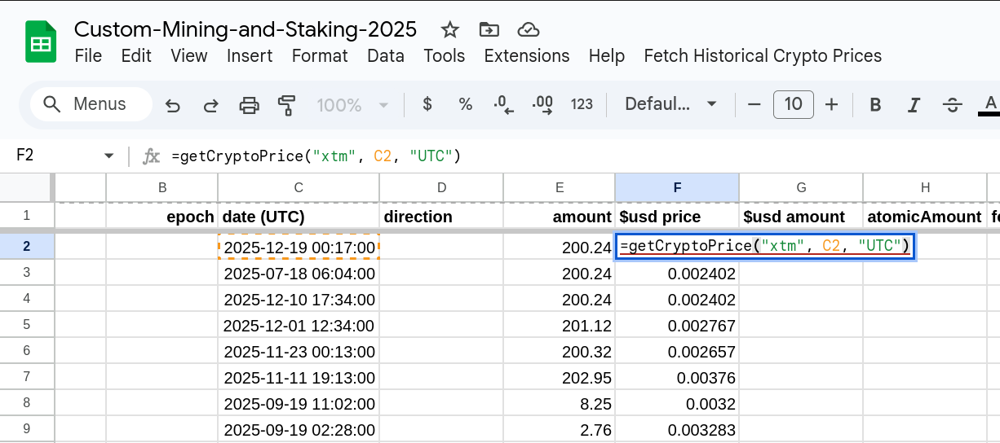

# Crypto Price Fetchers


[](https://github.com/nottoseethesun/crypto-price-fetchers/actions/workflows/ci.yml)
[](https://github.com/nottoseethesun/crypto-price-fetchers/actions/workflows/ci.yml)
[](https://github.com/nottoseethesun/crypto-price-fetchers/actions/workflows/security-audit.yml)

## Overview

Scripts that fetch crypto token prices in USD: the price now, and the
price at a past time, down to the minute.

**Historical prices.** crypto-price-filler, a program you run from a
terminal, prices a whole CSV file at once, such as a year of a miner's
payouts or of a wallet's transactions: it finds the price in USD at each
row's own time, and writes the rows again with each one's price and its
amount at that price, for the tokens its list of supported tokens names
([crypto-price-filler.js](#crypto-price-fillerjs)).

There are far more crypto tokens than most price-tracking services cover,
so those services have no price for many of them. These scripts ask where
such tokens trade: the centralized exchanges that list them, and, for a
token that trades in a blockchain's pools, the services that price those
pools.

The scripts run in Google Sheets, Google's spreadsheet app, as scripts
written in the "Apps Script" computer language, and equally also, as
stand-alone NodeJS scripts that are run from the Terminal on the
command-line. Apps Script is Google's platform for scripts that run
inside its apps: in a sheet, a cell calls a script's function as it calls
a built-in one. NodeJS, or Node, is the program that runs JavaScript
outside a browser. Each of the two
price tools has a folder of its own, which holds its Google Sheets
scripts (`.gs`), in its `src/`, its README and its settings:
[`crypto-price-fetchers/`](crypto-price-fetchers/README.md), the price
now, and
[`fetch-from-any-exchange/`](fetch-from-any-exchange/README.md),
the price at a past time, from centralized exchanges and, through
crypto-price-filler, from the pools of decentralized exchanges too. Each script
that gives a price has a Node version in `bin/end-user/`, with the same name
ending in `.js`, for programs and the command line on a computer, where
Node runs it. The
Node version runs the same `.gs` file, unchanged, so the two give the same
answers, and a fix to the script is a fix to both
([Node Versions of the Sheets Scripts](#node-versions-of-the-sheets-scripts)).
How each of them decides which price to give, and when it gives
none, is in
[`docs/price-determination-rules.md`](docs/price-determination-rules.md).

The repo also holds code that the other projects of its owner,
nottoseethesun on GitHub, the website that hosts the repos, install from
it: the key store, which keeps api
keys encrypted; the Summ CSV writer, which writes the CSV files that Summ,
his crypto tax calculator, imports; and the tool that sets which version
of this repo a project installs ([Development](#development)). It also
holds programs that serve the repo's own work and those projects, which
[`docs/engineering.md`](docs/engineering.md#the-programs-in-bin) covers.

### The Scripts

The programs you run from a terminal are in `bin/end-user/`, save two
that npm runs: `install/install-os-dependencies.js`, which
`npm run os-dependencies` runs once, at install, to install the
clipboard tool, and the build step, `build/tools/build.js`, which
`npm run build apps-script` runs to make the one file you paste into a
spreadsheet, `crypto-price-fetchers.gs`, and puts it on the clipboard, or
in `dist/apps-script/` when no clipboard tool is installed. The programs
in `bin/end-user/`, and that file, each have a sub-section below;
[Run](#run) shows each at work.

#### crypto-price-fetchers.gs

The one file a spreadsheet runs: Google Apps Script, in which a cell calls
a script's function as it calls a built-in one. The build step,
`npm run build apps-script` (`build/tools/build.js`), joins into it the
Sheets scripts of both tools and the menu, in the top `src/`, with the
saved api keys set at its end, for one paste into a spreadsheet
([Install in Google Sheets](#4-install-in-google-sheets)):

- `crypto-price-fetchers/src/crypto-price-fetchers.gs` gives a token's
  current price, and its fully diluted value. It asks DexTools, a service that prices tokens
  from the pools of decentralized exchanges, so it covers tokens on the
  chains DexTools lists, such as PulseChain, Ethereum and Solana. For X1,
  which DexTools does not list, it asks x1.ninja, a service that does the
  same for X1, instead.
- The exchange script,
  `fetch-from-any-exchange/src/getCryptoPriceFromCentralizedExchange.gs`,
  with its price sources in `-sources.gs` and its in-editor tests in
  `-tests.gs`, gives a token's price at a past time, as recent as a
  minute ago: by default the average of the high and the low of a period
  around that time, or else its high, low or close. It asks MEXC, a
  centralized exchange, then CoinGecko, then CoinPaprika, two services
  that gather the exchanges' prices, so it covers the tokens they price.
- `src/crypto-price-fetchers-menu.gs` adds the Crypto Price Fetchers menu
  to the spreadsheet. Its items run the price cells again, clear cells
  stuck on `#ERROR!` or on a busy message, replace past prices' formulas
  with their numbers, and show Help: how to use each function, made from
  the help section of each script's header.

The build can add the Google Sheets functions of DEX Screener, a service
that lists the pairs of decentralized exchanges with their prices, such
as `DEX_SCREENER_PAIR_PROP`, downloaded from DEX Screener's repo; this
repo holds none of their code.

A spreadsheet's scripts run within
[Apps Script's quotas](https://developers.google.com/apps-script/guides/services/quotas):
Google stops a cell's call after 30 seconds, runs at most 30 calls of one
person at once, and lets one person's scripts make 20,000 web requests a
day, or 100,000 with a Google Workspace account. The programs below run on
a computer, where none of those limits apply.

#### crypto-price-fetchers.js

The Node version of `crypto-price-fetchers/src/crypto-price-fetchers.gs`: it runs that script,
unchanged, under Node, and prints what its cell would show, a token's
price or fully diluted value now.

#### getCryptoPriceFromCentralizedExchange.js

The Node version of the exchange script: it runs the script's files,
unchanged, under Node, and prints what `getCryptoPrice` would show in a
cell, a token's price at a past time.

#### crypto-price-filler.js

crypto-price-filler prices each row of a CSV file of any length, at each
row's time. It asks the exchange script's own three price sources, run
under Node, and, for a token that trades in pools, Moralis and
GeckoTerminal first, two services that price a token from its chain's
pools ([Tokens That Trade in Pools](#tokens-that-trade-in-pools)). Its
code is the package in `fetch-from-any-exchange/crypto-price-filler/`,
which this start file loads.

#### backfill.js

crypto-price-filler's backfill fills each price the filler marked
`Error`, in a CSV file the filler wrote, with the price of the nearest
priced row before or after it, the higher of the two or the lower,
asking no service. Its code is the package's `backfill.js`, which this
start file loads.

#### manage-api-keys.js

The key manager: it lists the api keys the top `config.json` names, saved
or not, never showing a key's characters, and saves each key typed,
encrypted with your password, once its service takes it.

## Table of Contents

- [Overview](#overview)
  - [The Scripts](#the-scripts)
    - [crypto-price-fetchers.gs](#crypto-price-fetchersgs)
    - [crypto-price-fetchers.js](#crypto-price-fetchersjs)
    - [getCryptoPriceFromCentralizedExchange.js](#getcryptopricefromcentralizedexchangejs)
    - [crypto-price-filler.js](#crypto-price-fillerjs)
    - [backfill.js](#backfilljs)
    - [manage-api-keys.js](#manage-api-keysjs)
- [Disclaimer](#disclaimer)
- [Screenshot](#screenshot)
- [Prerequisites](#prerequisites)
- [Install](#install)
  - [1. Node and the Packages](#1-node-and-the-packages)
  - [2. Operating-System Programs](#2-operating-system-programs)
  - [3. The Api Keys](#3-the-api-keys)
  - [4. Install in Google Sheets](#4-install-in-google-sheets)
- [Optional: Verify Download](#optional-verify-download)
- [Update](#update)
- [Uninstall](#uninstall)
- [Run](#run)
  - [crypto-price-fetchers.gs](#crypto-price-fetchersgs-1)
    - [Usage of crypto-price-fetchers.gs](#usage-of-crypto-price-fetchersgs)
  - [crypto-price-fetchers.js](#crypto-price-fetchersjs-1)
    - [Usage of crypto-price-fetchers.js](#usage-of-crypto-price-fetchersjs)
  - [getCryptoPriceFromCentralizedExchange.js](#getcryptopricefromcentralizedexchangejs-1)
    - [Usage of getCryptoPriceFromCentralizedExchange.js](#usage-of-getcryptopricefromcentralizedexchangejs)
  - [crypto-price-filler.js](#crypto-price-fillerjs-1)
    - [Usage of crypto-price-filler.js](#usage-of-crypto-price-fillerjs)
  - [backfill.js](#backfilljs-1)
    - [Usage of backfill.js](#usage-of-backfilljs)
  - [manage-api-keys.js](#manage-api-keysjs-1)
    - [Usage of manage-api-keys.js](#usage-of-manage-api-keysjs)
- [Configure](#configure)
- [Lint & Test](#lint--test)
  - [Optional: the Clipboard Tool, by Hand](#optional-the-clipboard-tool-by-hand)
- [Private Key Security](#private-key-security)
- [Development](#development)
  - [Node Versions of the Sheets Scripts](#node-versions-of-the-sheets-scripts)
    - [From Node](#from-node)
  - [Tokens That Trade in Pools](#tokens-that-trade-in-pools)
  - [Projects That Install This One](#projects-that-install-this-one)
  - [Architecture and Engineering References](#architecture-and-engineering-references)
- [License](#license)
- [Road Map](#road-map)
- [Donations](#donations)
- [Contributing](#contributing)

---

## Disclaimer

USE AT YOUR OWN RISK: this software is provided "as is", without warranty
of any kind, as its [license](LICENSE) says. It has not been formally audited and may contain
bugs. The prices it gives come from outside services, which can be wrong,
late or missing for a token: check a price before you rely on it, for your
taxes or for anything else.

---

## Screenshot

A sheet of payouts of XTM, the coin of the Tari network, each priced in
USD at its date and time. Its "$usd price" column holds
`=getCryptoPrice("xtm", C2, "UTC")` and the like: the price at the time in
the same row of column C, read in UTC. The picture shows the menu under
its earlier name, Fetch Historical Crypto Prices, at the end of the menu
bar; it is now Crypto Price Fetchers.



---

## Prerequisites

- A terminal, in which the programs and npm run.
- Node 24 or later, from [nodejs.org](https://nodejs.org/), with npm, the
  package manager that comes with it, which installs a project's packages
  and runs the commands its `package.json` names. The repo is tested on
  Node 24 and 26.
- git, the version-control program, to clone the repo from GitHub, the
  website that hosts it.
- For the Sheets scripts: a Google account and a spreadsheet in Google
  Sheets. A clipboard tool, which the build puts the built file on, saves
  a step: without one, the build writes the file to disk
  ([Operating-System Programs](#2-operating-system-programs) installs
  one).
- Optional: an api key for each service that takes one
  ([The Api Keys](#3-the-api-keys)).

---

## Install

Step 1 installs the packages, which every tool needs. Step 2 installs
the programs of your computer's operating system that the tools use and
npm does not install: today the clipboard tool of the build step. Step 3
saves the api keys, each of them optional: with none saved, a tool asks
each service without a key, and gets what the table in step 3 says. Step
4 puts the Sheets scripts into a spreadsheet, as the one file the build
step gives.

### 1. Node and the Packages

Clone the repo, then, from its top folder, install the top folder's
packages, then those of crypto-price-filler, which has a package of its
own and uses the top folder's too. npm installs the packages each
folder's `package.json` lists, at the versions its `package-lock.json`
keeps:

```bash
git clone https://github.com/nottoseethesun/crypto-price-fetchers.git
cd crypto-price-fetchers
npm ci
npm ci --prefix fetch-from-any-exchange/crypto-price-filler
```

### 2. Operating-System Programs

One program the build step uses comes from your computer's operating
system rather than from npm: the clipboard tool, which puts the built
file on the clipboard ([step 4](#4-install-in-google-sheets)). macOS and
Windows come with theirs, pbcopy and clip. A Linux desktop needs
wl-clipboard in a Wayland session, or xclip in an X11 one, unless a tool
for the session, such as xsel, is installed. `npm run os-dependencies`
runs `install/install-os-dependencies.js`, which says what is installed
and installs what is missing. From the repo's top folder:

```bash
npm run os-dependencies
```

It installs the tool with Homebrew, the package manager for macOS and
Linux, when Homebrew is installed. Without Homebrew, it recommends
installing it, as [brew.sh](https://brew.sh) says, since it works on
Linux and macOS alike, then running `npm run os-dependencies` again; and,
where apt, the package manager of Debian and Ubuntu, is installed, it
asks whether to install the tool with `sudo apt install` instead, sudo
asking for your computer's password at its own prompt. With neither, or
when the install fails, it names the package to install yourself. With
no desktop session open, as over ssh, no clipboard can be reached, and
it installs nothing. `npm run os-dependencies -- --help` lists its exit
codes.

### 3. The Api Keys

The keys the tools send are kept in `api-keys.json` at the repo's top,
which git ignores, encrypted with one password you choose, by this repo's
key store, `api-key-store/`, which keeps keys as LP Ranger, the owner's bot
that manages his 9mm V3 liquidity positions, keeps its own. The top
`config.json` lists the services they are for:

| Service     | What it prices                                                          | Without a key                      |
| ----------- | ----------------------------------------------------------------------- | ---------------------------------- |
| CoinGecko   | Past prices, for the exchange script and crypto-price-filler            | Asked without one, at a lower rate |
| CoinPaprika | Past prices, the same; a key is for one of its paid plans               | Its free server: close prices only |
| Moralis     | Past prices of tokens that trade in pools, for crypto-price-filler      | Not asked                          |
| DexTools    | Current prices and fully diluted values, for `crypto-price-fetchers.gs` | No price: DexTools needs a key     |
| x1.ninja    | The same, on X1                                                         | No price: x1.ninja needs a key     |

`npm run api-keys` runs the key store's manager, `bin/end-user/manage-api-keys.js`. To
save the keys, from the repo's top folder:

```bash
npm run api-keys
```

It lists each key, saved or not, never showing its characters, and asks for
each one not saved: the key, then the password, showing nothing of what is
typed. The password is typed twice while no key is saved, and once
after that. A program that opens the keys, the key manager among them,
takes the password from the environment variable `API_KEYS_PASSWORD`
when it holds one, and asks for it only when it does not;
[`docs/engineering.md`](docs/engineering.md#the-programs-in-bin) says how
a terminal can keep it there. Each key is saved only once its service takes it; Enter
alone skips one. [manage-api-keys.js](#manage-api-keysjs-1), under
[Run](#run), shows its other uses. The store itself is a module
any Node project can use: see [its README](./api-key-store/README.md).

### 4. Install in Google Sheets

A spreadsheet runs its scripts from its Apps Script project, the code
Google keeps with the spreadsheet. Apps Script cannot read the key file,
so the keys must be written into the script itself. It also runs every
script file of a project in one global scope, as if the files were one,
so the scripts lose nothing by being joined. So this repo's build step,
`build/tools/build.js` with `build/tools/apps-script-build/`, joins them
into one file, `crypto-price-fetchers.gs`, with the
saved keys set at its end, which goes in with one paste. From the repo's
top folder:

```bash
npm run build apps-script
```

Before its first question, the build reads the config.json each script's
Node version reads, `crypto-price-fetchers/config.json` and
`fetch-from-any-exchange/config.json`, and checks it as that Node
version does: it stops, listing every problem, when a file sets a field
the script does not take or a value of the wrong kind
([Configure](#configure)).

1. **DEX Screener's functions.** The build first asks whether to include
   DEX Screener's Google Sheets functions, such as
   `DEX_SCREENER_PAIR_PROP`. DEX Screener wrote them, and this repo holds
   none of their code. Before it uses that code, the build checks that
   each file is the one this repo pinned: it downloads the files from DEX
   Screener's repo at the commit the question names, compares each file's
   SHA-256, a fingerprint of its contents, with the one written in this
   repo, and says the result; `npm run audit:dex-screener` runs the same
   check on its own. Then it compiles the checked files into the file. The
   step is optional: Enter, or y, includes them, and n leaves them out. If
   the build fails, run it again and answer n.
2. **The password.** The build opens the saved keys as the tools do, with
   the password from `API_KEYS_PASSWORD`, or, when that holds none, asks
   for it.
3. **The clipboard.** The build puts the file on the clipboard and says how
   to paste it.
4. **Paste.** In the spreadsheet, open Extensions > Apps Script. Open the
   script file `crypto-price-fetchers`, or make it (Files, +, Script, named
   `crypto-price-fetchers`), select all of its text, paste over it, and
   save.
5. **Delete the files it replaces,** where the project has them from an
   earlier install: `getCryptoPriceFromCentralizedExchange`,
   `getCryptoPriceFromCentralizedExchange-sources`,
   `getCryptoPriceFromCentralizedExchange-tests`, and, when DEX Screener's
   functions went in, DEX Screener's own file. Each declares names the
   pasted file declares too: a project that declares a name twice with
   `const` stops with an error at every run, and of two functions with one
   name, the one that runs last replaces the other. Apps Script calls the
   one function named `onOpen` when the spreadsheet opens, so another
   script in the project that defines `onOpen` hides one of the two menus.
6. **Clear the clipboard.** Back in the terminal, press Enter.
7. **Reload the spreadsheet.** The Crypto Price Fetchers menu appears, and
   its Help item says how to use each function. The first item you choose
   asks you to approve what the script may do.

DEX Screener's own file sets an `onOpen` of its own as it runs, and
Google's documentation does not say in which order Apps Script runs a
project's files. So with DEX Screener's own file kept beside the pasted
one, either menu can be the one that appears, as step 5 says. To have DEX Screener's
functions under the Crypto Price Fetchers menu, build with them included.

The clipboard is reached through the desktop's own tool: wl-copy, xclip or
xsel on Linux, pbcopy on macOS, clip on Windows. When none is installed,
on a Linux desktop with Homebrew or apt, the build offers the install
`npm run os-dependencies` runs ([step 2](#2-operating-system-programs)),
and runs it on a yes. Declined, failed, or with no install to offer, the
build says first that your api keys will be written to disk in the clear,
then writes the file to
`dist/apps-script/crypto-price-fetchers.gs`, which git ignores, readable
by you alone, and prints its path and how to paste it, never its text.
Delete it once it is pasted.

A copy with keys in it is for pasting into Apps Script only: never commit
or share it. A clipboard manager that keeps a history of what was copied
keeps the script too.

---

## Optional: Verify Download

Shows that your clone is at the commit GitHub has, and that the packages
npm installed are the ones the lockfiles name.

git names each commit by a hash of its files and its history, so a
commit's name changes when any of its files does, and two clones at
commits of the same name hold the same files. From the repo's top folder,
these print the commit you have and the commit GitHub has for `main`; the
same 40 characters in both mean you hold the code GitHub holds:

```bash
git rev-parse HEAD
git ls-remote https://github.com/nottoseethesun/crypto-price-fetchers.git main
```

A release is a version tag, such as `1.3.0`: `git rev-list -n 1 1.3.0`
prints the commit it names.

`npm ci` checks every package it downloads against the hash
`package-lock.json` keeps for it, its `integrity`, and stops when one
differs. Two more downloads are checked against SHA-256 hashes this repo
pins: the files of DEX Screener's functions, by the build and by
`npm run audit:dex-screener`, and actionlint, the checker of GitHub
Actions workflow files, by `run-actionlint`, the repo's bin that runs it
in the lint.

---

## Update

From the repo's top folder, take the newest commit of `main`, then install
the packages its lockfiles name:

```bash
git pull
npm ci
npm ci --prefix fetch-from-any-exchange/crypto-price-filler
```

The api keys, in `api-keys.json`, and your settings in the config.json
files git ignores stay as they are. The top `config.json` is a file git
keeps: when you changed it and a newer commit changes it too, `git pull`
stops rather than write over your change, and `git stash`, then
`git pull`, then `git stash pop` carries your change across. A spreadsheet keeps the scripts as
they were pasted: to update them, run the build again and paste the new
file over the old one, as in
[Install in Google Sheets](#4-install-in-google-sheets). A project that
installs this repo takes its newest commit with
`npm run github-project-deps -- main`
([github-project-deps.js](docs/engineering.md#github-project-depsjs)).

---

## Uninstall

1. In each spreadsheet that has the scripts, open Extensions > Apps
   Script, delete the script file `crypto-price-fetchers`, which holds your
   api keys, and reload the spreadsheet: the Crypto Price Fetchers menu is
   gone. The script also kept the time of its last DexTools call as a
   script property, `lastDexToolsCall`, which Project Settings > Script
   Properties lists and can delete.
2. In each terminal where `API_KEYS_PASSWORD` holds the password, run
   `unset API_KEYS_PASSWORD`, or close the terminal.
3. From the folder that holds it, delete the repo's folder, which holds
   `api-keys.json`:

   ```bash
   rm -rf crypto-price-fetchers
   ```

4. A clipboard manager that keeps a history of what was copied keeps the
   built file, with its keys: delete it from that history. To retire the
   keys themselves, revoke them at each service.
5. A clipboard tool that `npm run os-dependencies` installed stays: other
   programs may use it too. `brew uninstall xclip` or
   `sudo apt remove xclip`, with `wl-clipboard` in place of `xclip` for
   a Wayland session, removes it.

---

## Run

The programs are in `bin/end-user/`. Each sub-section below covers one:
first an example of how to run it, then what it does, and, under its
Usage, more examples, of the options and cases that take more. Run them
from the repo's top folder with `node`, or through the npm target a
sub-section names. Each command line answers `--help`
with its options, more examples and its exit codes, and
[`docs/project-commands.md`](docs/project-commands.md) lists every
command with its flags.

crypto-price-filler, which reads files of yours, takes them from its
folder's `input/`, and writes its results in its folder's `output/`, in
`output/csv/` for csv files. The files hold
your own data and the repo is public, so git keeps nothing in those
folders but the folders. The examples below keep your files there.

The one file a spreadsheet runs, `crypto-price-fetchers.gs`, is not in
`bin/end-user/`: `npm run build apps-script` makes it, and puts it on the
clipboard, or, when no clipboard tool is installed, in
`dist/apps-script/`, from where you paste it into the spreadsheet
([Install in Google Sheets](#4-install-in-google-sheets)).

### crypto-price-fetchers.gs

```text
=dexToolsGetTokenPrice("ether", "0xA0b86991c6218b36c1d19D4a2e9Eb0cE3606eB48")
```

In a cell of a spreadsheet the file is pasted into, this gives USDC's
price on Ethereum, about 1.00: a cell calls one of the file's functions by
name, as it calls a built-in one. Crypto Price Fetchers > Help, in the
spreadsheet's menu bar, shows each function's full help.

#### Usage of crypto-price-fetchers.gs

##### A Price Now: dexToolsGetTokenPrice and dexToolsGetTokenFDV

`dexToolsGetTokenPrice(chain, tokenAddress, [pool], [seconds])` gives a
token's price in USD now, and
`dexToolsGetTokenFDV(chain, tokenAddress, [pool], [seconds])` its fully
diluted value (FDV): its price times its total supply. Both ask DexTools,
or x1.ninja for X1.

- `chain` names the chain as DexTools names it, in lower case, such as
  `ether` for Ethereum, `pulse`, `bsc` or `solana`; or `x1`.
- `pool` names one pool: its address, in quotes or in a cell, or written
  with a 0 in double braces, `{{"<pool-address>", 0}}`, as earlier sheets
  write it. X1 needs it, since x1.ninja answers only for
  a pool. Elsewhere the price function prices the token in that pool, and
  the FDV function does not read it, since DexTools' FDV belongs to the
  token.
- `seconds`, a whole number from 1 to 21600, is how long a number above 0
  is kept, so a cell that runs again within that time gives the same
  number; without it, `CACHE_SECONDS`, 300 seconds as the script is
  written ([Configure](#configure)).

A token's FDV on PulseChain:

```text
=dexToolsGetTokenFDV("pulse", "0xF84b84dAAce6Ac00DbBAed26CA32Ff3570Aaf66C")
```

Wrapped XNT's price on X1, in its pool with USDC.X, kept for 10 minutes:

```text
=dexToolsGetTokenPrice("x1", "So11111111111111111111111111111111111111112", {{"CAJeVEoSm1QQZccnCqYu9cnNF7TTD2fcUA3E5HQoxRvR", 0}}, 600)
```

A cell shows 0 when the service has no data for the token or pool, or
refused the request, with a status below 500, so that the sheet's sums
keep working; `⌛ Rate limit / busy – retry soon` when other cells kept
the script busy for longer than it waits for them;
`⚠️ API error – check logs` when the request got no answer, as when
Apps Script's daily quota of requests is used up or the network fails,
when the service failed, with a status of 500 or above, or when its
answer cannot be read, which the cell asks again the next time it runs;
and a message naming the rule when `seconds` is another value, in which
case the script asks nothing.

##### A Past Price: getCryptoPrice

`getCryptoPrice(token, dateStr, tz, mode)` gives a coin's price in USD
at a past time, from MEXC, then CoinGecko, then CoinPaprika. Each source
prices a period that holds the time. MEXC's is the minute, for a time in
about the last 30 days, else the hour; when nothing traded in it, the
script widens it a step at a time, up to the year, among the periods
already over: for a time in the minute not yet over, the cell says when
to ask again, and when the next period up is not over, CoinGecko
answers. A larger period may hold only trades from after a time that
comes before the coin's first trade on MEXC, which comes on the day MEXC
listed it. So when MEXC gives no candle of a recent time's minute, or of
the hour, or the request for it fails, the script asks for the day
before, whose candle shows the coin traded before that day: with none,
or when that request fails too, CoinGecko answers. CoinGecko's is the 24
hours from 12 hours before the time to 12 after, whose price the script
takes only once they are over, and CoinPaprika's the day, in UTC, whose
price it takes only once the day is over.

- `token` is the coin's ticker symbol, such as `"btc"` or `"xmr"`.
- `dateStr` is the time, written `"YYYY-MM-DD HH:MM:SS"` on a 24-hour
  clock, or a cell that holds a date and time.
- `tz` is the time zone of that time, by its abbreviation: UTC, GMT, EST,
  EDT, CST, CDT, MST, MDT, PST or PDT, as the script is written; left
  empty, UTC.
- `mode` is `"average"`, the average of the period's highest and lowest
  price, unless it is `"high"`, `"low"` or `"close"`, the price at the
  period's end, or, from CoinGecko, its hourly price nearest the time, or,
  when its hourly prices are empty, its price at 00:00 UTC the next day,
  which ends the time's UTC day. When MEXC has to widen its period to
  find a trade, every mode gets that period's average.

XTM's average price at the time in cell C2, read in UTC, as in the
[Screenshot](#screenshot):

```text
=getCryptoPrice("xtm", C2, "UTC")
```

Monero's lowest price at the time in cell A1:

```text
=getCryptoPrice("xmr", A1, "UTC", "low")
```

Bitcoin's highest price in the period around 14:30, US Central time, on
15 January 2026:

```text
=getCryptoPrice("btc", "2026-01-15 14:30:00", "CST", "high")
```

A cell shows a message instead of a price when no source has one for that
coin at that time, when the time is in the future, when the time is in
the minute not yet over, whose price at MEXC can still change, when MEXC
has no price and a later source's period that holds the time is not over
(CoinGecko's
24 hours around a time less than 12 hours ago, while CoinGecko prices the
coin, or CoinPaprika's day, in UTC, for a time today), when no source has
a price for an average, a high or a low and no CoinPaprika key is set,
which CoinPaprika needs for those, when other cells
kept the script busy, when no source gave a price and a
request got no answer
(refused as too many on its last try or past the 25 seconds the script
allows a call, answered with a server error or a request timeout, or given
no response, as when Apps Script's daily quota of requests is spent), or when it cannot read
`tz` or `dateStr`; Help lists each message.

##### The Menu

The Crypto Price Fetchers menu, in the spreadsheet's menu bar, runs the
price cells again:

- Clean up errors runs again every cell that calls one of the functions
  above, or a DEX Screener function, and shows `#ERROR!` or a busy
  message.
- Refresh runs again every cell that asks for a price now, or a DEX
  Screener function.
- Refresh & freeze historical prices (this tab) runs again every cell of
  the tab you are on that calls `getCryptoPrice`, then replaces each
  formula that gave a number with that number, since a past price does
  not change, with these exceptions. CoinGecko says it may revise a price
  for up to 2 days after its date, and a price for a time can come from
  CoinGecko's prices of the next UTC day, which can change until the end
  of the second day after it, when the fourth day after the time's UTC
  day begins. The item keeps the price each cell kept, which may have
  been asked of CoinGecko up to 12 hours earlier, since the script keeps
  a cell's price for up to 6 hours and the prices CoinGecko gave it for
  up to 6 more; so freeze a tab only once its times are 5 days old, when
  the fourth day after each time's UTC day began at least a day before. And a coin that traded nothing on
  MEXC in the UTC day that holds a time takes the next source's price until
  MEXC can give the average of a larger period that holds the time, each
  in UTC: the week, which MEXC counts from Monday 00:00, once it is over;
  or, when nothing traded in the week either, the month, once it and the
  week are over, since a week from Monday can end after its month or its
  year; or, when nothing traded in the month either, the year, once it
  and the week are over. A cell keeps the price it gave for up to
  6 hours, so freeze a tab that holds such a cell only once that period
  and the week have been over 6 hours. MEXC keeps its minute candles for
  about 30 days. A price it gave from them, or as the hour's average
  because nothing traded in the minute, can change once MEXC lets them
  go, so freeze a tab that holds such a cell within about 30 days of its
  times.
- Help shows how to use each function.

##### DEX Screener's Functions

When the build included them, DEX Screener's own functions are in the
sheet too, and Help describes them. A pair's price in USD, from DEX
Screener's listing of a pair on PulseChain:

```text
=DEX_SCREENER_PAIR_PROP("pulsechain", "<pair-address>", "priceUsd")
```

DEX Screener gives `priceUsd` as text, which `SUM` skips; `VALUE()` turns
it into a number.
[DEX Screener's repo](https://github.com/dexscreener/google-sheets)
documents the functions.

##### Building the File Again

The build sets the saved keys in the file, so a key saved or changed
reaches the spreadsheet once the file is built and pasted again. The
file, built with the key store's password, from `API_KEYS_PASSWORD` or
typed when the build asks for it:

```bash
npm run build apps-script
```

### crypto-price-fetchers.js

```bash
node bin/end-user/crypto-price-fetchers.js price ether 0xA0b86991c6218b36c1d19D4a2e9Eb0cE3606eB48
```

This prints USDC's price on Ethereum, from the pools DexTools picks:
`bin/end-user/crypto-price-fetchers.js` prints what a cell of
`crypto-price-fetchers/src/crypto-price-fetchers.gs` would show, `price`
a token's price in USD now, and `fdv` its fully diluted value.

#### Usage of crypto-price-fetchers.js

It sends DexTools' key, or x1.ninja's for X1, opened with the password,
from `API_KEYS_PASSWORD` or asked for. `--pool` names the
pool to price the token in, which X1 needs.

Wrapped XNT's price on X1, in its pool with USDC.X:

```bash
node bin/end-user/crypto-price-fetchers.js price x1 So11111111111111111111111111111111111111112 --pool CAJeVEoSm1QQZccnCqYu9cnNF7TTD2fcUA3E5HQoxRvR
```

A token's fully diluted value on PulseChain, with the script's log, which
shows what DexTools answered, on stderr:

```bash
node bin/end-user/crypto-price-fetchers.js fdv pulse 0xF84b84dAAce6Ac00DbBAed26CA32Ff3570Aaf66C --verbose
```

It prints the number, with exit code 0, or the script's message on stderr,
with exit code 1. A 0 is the script's answer when the service has no data
for the token or refused the request, as it gives a cell; a request that
got no answer, a service that failed, or an answer that cannot be read
gives the script's message. A run on X1 with no `--pool` is refused, with
exit code 1, before anything is asked.

### getCryptoPriceFromCentralizedExchange.js

```bash
node bin/end-user/getCryptoPriceFromCentralizedExchange.js btc "2026-01-15 14:30:00"
```

This prints Bitcoin's average price in the period around 14:30 UTC on 15
January 2026: `bin/end-user/getCryptoPriceFromCentralizedExchange.js`
prints what `getCryptoPrice` would show in a cell.

#### Usage of getCryptoPriceFromCentralizedExchange.js

`--tz` names the time zone of the time, UTC unless given, and `--mode` the
price: `average`, unless given, `high`, `low` or `close`. A time zone the
script does not know, or a time the calendar does not have, is refused,
naming `--tz` or the date, before a key is opened or anything is asked.
It sends the CoinGecko and CoinPaprika keys when they are saved.

Gridcoin's close at a time given in US Central time:

```bash
node bin/end-user/getCryptoPriceFromCentralizedExchange.js grc "2026-01-15 08:30:00" --tz CST --mode close
```

Monero's low, with the script's log on stderr, which shows the service
that answered:

```bash
node bin/end-user/getCryptoPriceFromCentralizedExchange.js xmr "2026-01-15 14:30:00" --mode low --verbose
```

It prints the number, with exit code 0, or the script's message on stderr,
with exit code 1.

### crypto-price-filler.js

```bash
node bin/end-user/crypto-price-filler.js --token=grc --input=fetch-from-any-exchange/crypto-price-filler/input/mining.csv
```

This writes Gridcoin's close at each row's time, read in UTC, to
`fetch-from-any-exchange/crypto-price-filler/output/csv/output.csv`.
`bin/end-user/crypto-price-filler.js` prices each row of a CSV file at the
time in its column of dates, written `yyyy-MM-dd HH:mm:ss` and read in
the time zone `--tz` names, UTC by default: the first column whose name
holds "date", in any letter case, and "UTC", in capitals, or else the
first whose name holds "date". It
writes the file again with three columns added: `$usd price`, by default the
close of the period that holds the row's time, or CoinGecko's hourly
price nearest it, or, when CoinGecko's hourly prices are empty, its price
at 00:00 UTC the next day, which ends the time's UTC day, or, for a token
that trades in pools, Moralis's price at the block the chain had at the
row's time, or, when MEXC must widen the period to find a trade, that
period's average; `$usd amount`, the row's
amount at that price; and `grand total ($usd)`. Your files go in its
folder's `input/`, `fetch-from-any-exchange/crypto-price-filler/input/`, and it writes, by default, `output.csv`
in its folder's `output/csv/`; git keeps nothing in either folder but
the folder.

#### Usage of crypto-price-filler.js

`--token` must be one of the tokens its `supported-tokens.json` lists. A
row no service priced gets `Error` in `$usd price`: `--backfill-highest`
or `--backfill-lowest` fills it in the same run, or, afterwards,
`bin/end-user/backfill.js`, which fills it in the file the filler wrote, asking no
service ([backfill.js](#backfilljs-1)). With api keys
saved, a run opens them with the key store's password, from
`API_KEYS_PASSWORD` or asked for. It reads its own files from its
package's folder, and writes its default output there, so it runs from
any folder, and takes the paths `--input` and `--output` name from the
folder it runs in.
[Its README](fetch-from-any-exchange/crypto-price-filler/README.md)
covers its settings and the tokens it knows.

XTM's high at each row's time, the times read in US Central time, written
to `prices.csv` in its `output/csv/`, with each step logged:

```bash
node bin/end-user/crypto-price-filler.js --token=xtm --input=fetch-from-any-exchange/crypto-price-filler/input/input.csv --output=fetch-from-any-exchange/crypto-price-filler/output/csv/prices.csv --mode=high --tz=America/Chicago --verbose
```

With no CoinPaprika key saved, it first asks whether to go on without
CoinPaprika's prices, since CoinPaprika gives no high without one: y goes
on.

Gridcoin's close at each row's time, then, for each row no service
priced, the higher of the prices of the nearest priced rows before and
after it:

```bash
node bin/end-user/crypto-price-filler.js --token=grc --input=fetch-from-any-exchange/crypto-price-filler/input/mining.csv --backfill-highest
```

`npm start -- <options>`, in `fetch-from-any-exchange/crypto-price-filler/`,
runs the same command line.

### backfill.js

```bash
node bin/end-user/backfill.js --input=fetch-from-any-exchange/crypto-price-filler/output/csv/output.csv --backfill-highest
```

This fills, in place, each price marked `Error` in the `output.csv` the
filler wrote in its `output/csv/` with the higher of the prices of the
nearest priced rows before and after it, a figure that does not
understate a value for taxes. `bin/end-user/backfill.js` fills the
prices crypto-price-filler could not give, in a file it wrote, asking no
service: `--backfill-highest` takes the higher of the two prices, and
`--backfill-lowest` the lower.

#### Usage of backfill.js

The rows that hold no data, a "Total" row, a row with no date and the
rows after the last date, have a blank price, which backfill leaves as it
is, so they stay out of the grand total.

`budget.csv` written beside it with the lower price, a figure that does
not overstate income:

```bash
node bin/end-user/backfill.js --input=fetch-from-any-exchange/crypto-price-filler/output/csv/output.csv --output=fetch-from-any-exchange/crypto-price-filler/output/csv/budget.csv --backfill-lowest
```

The same fill in place with the higher price, printing the files, the mode, the columns it reads and the rows it filled:

```bash
node bin/end-user/backfill.js --input=fetch-from-any-exchange/crypto-price-filler/output/csv/output.csv --backfill-highest --verbose
```

### manage-api-keys.js

```bash
npm run api-keys
```

This lists each key the top `config.json` names, saved or not, never
showing its characters, with a question for each one not saved:
`npm run api-keys` runs `bin/end-user/manage-api-keys.js`, the key
manager.

#### Usage of manage-api-keys.js

DexTools' saved key replaced, as after DexTools issues a new one:

```bash
npm run api-keys -- set dextools
```

Whether the password in `API_KEYS_PASSWORD` opens every saved key, by its
exit code, 0 when it does; run with no `API_KEYS_PASSWORD` set, it says so
and ends with exit code 1:

```bash
npm run api-keys -- check-password
```

---

## Configure

The tools run as they come; a settings file changes how one runs. Each
file is JSON, checked against its JSON Schema, a description of the keys
the file may hold and the kind of value each takes, before the tool takes
any setting: a key the tool does not read, or a value of the wrong kind,
stops the run, with every problem listed, one line each.

| File | Read by | Holds |
| ---- | ------- | ----- |
| `config.json`, at the repo's top | the key store and the build | `apiKeys`, the services whose keys the project keeps |
| `crypto-price-fetchers/config.json`, which git ignores | `bin/end-user/crypto-price-fetchers.js` and the build | `DEXTOOLS_CONFIG`, with `CACHE_SECONDS`, how long a price above 0 is kept, from 1 to 21600 seconds, and `LOCK_WAIT_MS`, how long a call waits for the script's lock, from 0 to 20000 milliseconds, which keeps 10 of the 30 seconds Google gives a cell's call for the request |
| `fetch-from-any-exchange/config.json`, which git ignores | `bin/end-user/getCryptoPriceFromCentralizedExchange.js` and the build | fields of the exchange script's `CONFIG`, such as `QUOTE_CURRENCY`, `USDT` or `USDC`, the stablecoin of the MEXC pairs it asks |
| `fetch-from-any-exchange/crypto-price-filler/config.json`, which git ignores | crypto-price-filler | the settings that differ from its committed `config-example.json` |
| `fetch-from-any-exchange/crypto-price-filler/supported-tokens.json` | crypto-price-filler | the tokens `--token` takes, each with its ids at CoinGecko and CoinPaprika and its symbol at MEXC and, for a token that trades in pools, its contract and its chain's ids at GeckoTerminal and Moralis |
| `summ-csv/settings.json` | the Summ CSV writer | each chain's facts: its own coin and the forms of its hashes and addresses |

Beside each `config.json` is a `config-example.json`, which git keeps,
holding the same settings with their default values: copy it to
`config.json`, beside it, and change what you need. The build writes the
values of the two Node versions' files into the Sheets file, so a
spreadsheet runs on the settings the Node versions run on. The header of
each script describes its settings, and
[Settings Files](docs/architecture.md#settings-files) explains the
schemas.

---

## Lint & Test

The gate, LP Ranger's, runs the lint, the tests and the security audits,
and must pass before every commit and push. The lint runs ESLint, which
checks JavaScript against rules; markdownlint, which checks the form of
Markdown files; the check of Prettier, a program that formats code;
actionlint; and knip, which finds files nothing uses. From the repo's top
folder, after install step 1:

```bash
npm run lint          # the linters above
npm test              # the top folder's tests, on Node's test runner
npm run test:filler   # crypto-price-filler's tests
npm run check         # the whole gate, as CI runs it
```

The tests ask no outside service: the scripts' web requests go to
stand-ins on the computer. The Sheets scripts also hold tests that run
only in Apps Script, by hand:
[How the Sheets scripts are tested](docs/engineering.md#how-the-sheets-scripts-gs-are-tested)
sets the two kinds apart.

### Optional: the Clipboard Tool, by Hand

The tests never run a real clipboard tool: the build's tests hand its
copy to a stand-in, and the tests of the copy itself hand it a stand-in
for Node's spawn or, in one, Node itself as the tool. Whether the build
reaches your desktop's clipboard is checked by hand, on a desktop with
the tool installed ([step 2](#2-operating-system-programs)):

1. Run `npm run build apps-script` and answer its questions. It says
   "The script, N lines, is on your clipboard."
2. Paste into a text editor: the script's text appears. Back in the
   terminal, press Enter: it says "The clipboard is cleared.", and a
   paste gives nothing.
3. On Linux with xclip or xsel installed, run it again with a display
   that does not exist: `DISPLAY=:99 WAYLAND_DISPLAY= npm run build
   apps-script`. With `WAYLAND_DISPLAY` empty, the build uses xclip or
   xsel; the tool cannot open the display, and the build stops with
   "xclip exited with code 1", or the same words with xsel's name and
   exit code, with exit code 1 and no stack trace. Skip this step where
   wl-copy is the only tool, as on a Wayland desktop with only
   wl-clipboard installed: the build would find no tool, and offer to
   install xclip.

---

## Private Key Security

No tool here holds a wallet's private key or seed phrase: the tools read
prices and write files.

The api keys are kept in `api-keys.json`, which git ignores, each
encrypted by AES-256-GCM with a key made from your password by
PBKDF2-SHA512 at 600,000 rounds, as LP Ranger keeps its keys. The password
is kept nowhere on disk, and each tool holds the keys only in memory, for
one run. No tool prints a key's characters.

The one copy of the keys outside that file is the one the build sets in
the Sheets file, in the clear, since Apps Script cannot read the key file.
It goes to the clipboard, which the build clears once you press Enter,
or, with no clipboard tool, to `dist/apps-script/`, readable by you
alone. Never commit or share that file, and delete it once it is pasted.

**A lost password cannot be recovered**, and the keys saved with it cannot
be opened: delete `api-keys.json` and save each key again with
`npm run api-keys`, under a new password.

---

## Development

The repo follows the coding standards of LP Ranger: its `CLAUDE.md` and
everything under its `docs/claude/`.

### Node Versions of the Sheets Scripts

A Node version lets a Node program or the command line call a Sheets
function, and get what its cell would show. It runs the Sheets script
itself. The runner in `apps-script-runner/` loads the `.gs` file under
Node, and supplies the Apps Script services the script calls: web
requests, cache, lock, script properties, sleep, date formatting and logs.
It runs the script in a worker thread, a second thread of JavaScript that
Node runs beside the main one, so the script can wait for each web
request as it does in Apps Script ([why](docs/architecture.md#the-runner)).

What differs from the sheet:

- It runs on your computer, so there is no daily cap on web requests.
  Google's 30-second limit per call is not there either, though
  `getCryptoPrice` keeps to the 25 seconds its script allows a call, as
  in a cell, and shows the busy message when no source gave a price and a
  request got no answer, as in a cell.
- The api keys come from the repo's encrypted key file
  ([The Api Keys](#3-the-api-keys)), not from the script. Each Node
  version sets them in the script's config as it opens the script, as the
  build step sets them in the file it gives for the sheet.
- The cache lasts while the script is open: for the command line, one run.
- The sheet's menu is not there.

Each Node version reads its `config.json` when it is there, in its
tool's folder: `crypto-price-fetchers/config.json` for
`bin/end-user/crypto-price-fetchers.js` and
`fetch-from-any-exchange/config.json` for
`bin/end-user/getCryptoPriceFromCentralizedExchange.js`, and sets its values in the
script's config objects, as the build sets them for the sheet
([Configure](#configure)). The file may set only the fields its Node
version's `CONFIG_SCHEMAS` names: those the script reads each time it is
called, each of its kind of value, which leaves out the api keys.

#### From Node

A Node program imports a Node version, opens it once, and calls its
functions:

```js
import { openCentralizedExchangePrices } from './bin/end-user/getCryptoPriceFromCentralizedExchange.js';

const prices = await openCentralizedExchangePrices();
const high = await prices.getCryptoPrice('xtm', '2026-01-15 14:30:00', 'CST', 'high');
await prices.close();
```

The functions take the Sheets arguments and return what the cell would show.
`openCentralizedExchangePrices({ apiKeys: { coingecko, coinpaprika } })`
sends the keys given, such as those `unlockProjectKeys` (`api-key-store/`)
opens. `openCentralizedExchangeSources` opens the script's three price
sources instead, each taking an id, a time in UTC milliseconds and a
target, as crypto-price-filler asks them.

### Tokens That Trade in Pools

A token that trades in a blockchain's pools, such as HEX on PulseChain, is
priced by the services that read those pools, in LP Ranger's order:
Moralis first, which gives the price at the block the chain had at the
time, when a Moralis key is saved; then GeckoTerminal, for the last 180
days, from the candles of one pool: of the first pools GeckoTerminal
lists for the token, the deepest that traded in the last day. Their clients are in `dex-prices/`, with the
one loop that sends a request again when a service refuses it as one too
many, which every client shares.

crypto-price-filler prices such a token this way, and falls back to the
exchange script's three sources: MEXC, then CoinGecko, then CoinPaprika.
Other repos install this one to use the clients, as
`crypto-price-fetchers/dex-prices/geckoterminal`,
`crypto-price-fetchers/dex-prices/moralis`,
`crypto-price-fetchers/dex-prices/dextools` and
`crypto-price-fetchers/dex-prices/web-request`, alongside the runner, as
`crypto-price-fetchers/apps-script-runner`, and the key store, as
`crypto-price-fetchers/api-key-store`.

### Projects That Install This One

Three of the owner's projects install this repo from GitHub:
pulsechain-analytics, his tools for questions about PulseChain;
pulsechain-validator-analytics, for his PulseChain validators' withdrawal
addresses and payments; and x1-validator-analytics, for his X1
validator's rewards. Each project's lockfile keeps the commit its ref
named when the lockfile was made, and `npm ci` installs that commit;
[the versions tool](docs/engineering.md#github-project-depsjs)
moves it, and
[Which version they install](docs/architecture.md#which-version-they-install)
explains how.

The projects also take their checks from here. Their lint runs this repo's
bin `run-actionlint`, which runs actionlint from its author's release and
refuses the archive unless its SHA-256 is the one this repo pins, and
`no-or-default`, this repo's ESLint rule against a default made with
`||`; their security lint runs `no-secret-logging`, its rule against
printing a name that may hold a secret. Their tests hold
each command line's help to the owner's rule, and their tracked files to
his rules on addresses and docs, with
`crypto-price-fetchers/lib/command-line-help` and
`crypto-price-fetchers/lib/repo-checks`.

### Architecture and Engineering References

The `docs/` folder holds five references:

- [`docs/architecture.md`](docs/architecture.md): how the parts fit.
- [`docs/price-determination-rules.md`](docs/price-determination-rules.md):
  how each tool decides which price to give, and when it gives none.
- [`docs/claude/CLAUDE-DOC-AUDIT.md`](docs/claude/CLAUDE-DOC-AUDIT.md):
  the documentation audit every doc and JSDoc block passes, in full.
- [`docs/engineering.md`](docs/engineering.md): the files, the gates, the
  tests and CI: the checks GitHub runs, through its GitHub Actions
  service, on each pull request and each push to `main`.
- [`docs/project-commands.md`](docs/project-commands.md): every command,
  with its flags and an example.

---

## License

Licensed under the Apache License, Version 2.0. See [LICENSE](LICENSE) for
the full text.

---

## Road Map

The repo lists no planned work yet, and no bug is known.

---

## Donations

The owner takes donations for his projects at the address in
[LP Ranger's Donations](https://github.com/nottoseethesun/lp-ranger#donations).

---

## Contributing

Bug reports and ideas for new features and improvements are welcome, in
the [Issues](https://github.com/nottoseethesun/crypto-price-fetchers/issues)
tab. A bug report is most useful with the command or the cell's formula
you ran, and what it gave. A change must pass `npm run check`
([Lint & Test](#lint--test)).
