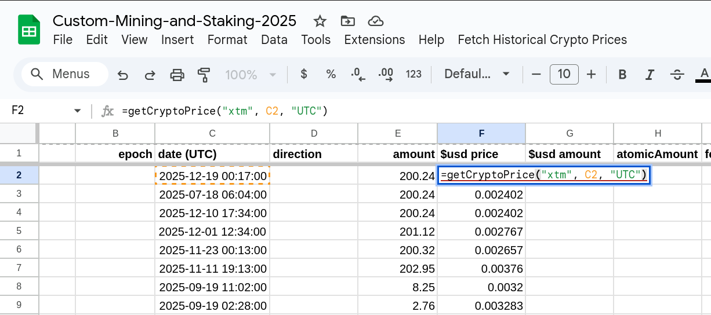

# Fetch Crypto Price from Centralized Exchange

## Overview

**USE AT YOUR OWN RISK: SEE LICENSE FILE IN PARENT DIRECTORY.**

This directory contains utilities for fetching historical
cryptocurrency prices from centralized exchanges (CEXs).
These tools are designed for tokens that don't trade on
decentralized exchanges, such as Bitcoin (BTC), Monero (XMR),
and Tari (XTM).

A token that trades in a decentralized exchange's pool can be
priced from the pool, through DexScreener's or DexTools' API. A
token that trades only on centralized exchanges has no pool, so
its price has to come from an exchange's API: MEXC's first, then
CoinGecko's or CoinPaprika's.

## Tools

This directory contains two separate implementations for
different use cases, and a Node version of the first:

| Tool                                | Use Case                          | Capacity              |
|-------------------------------------|-----------------------------------|-----------------------|
| **Google Apps Script**              | Google Sheets                     | ~100 calls per run    |
| **Node.js CLI**                     | Batch processing CSVs             | Thousands of rows     |
| **Node version of the Apps Script** | Node programs and one-off lookups | No Apps Script limits |

---

### 1. Google Apps Script (`getCryptoPriceFromCentralizedExchange.gs`)

A custom `=getCryptoPrice()` function for Google Sheets. It asks
MEXC for the price first, then CoinGecko, then CoinPaprika. It
caches each answer, and its lock makes the calls of many cells
take turns, so a sheet stays within each service's rate limit.

The script is in three files, each pasted into a script file of its own in
Apps Script, which loads a project's script files into one scope:

- [`getCryptoPriceFromCentralizedExchange.gs`](./getCryptoPriceFromCentralizedExchange.gs):
  `=getCryptoPrice()`, its settings, the cache and the menu.
- [`getCryptoPriceFromCentralizedExchange-sources.gs`](./getCryptoPriceFromCentralizedExchange-sources.gs):
  the price sources.
- [`getCryptoPriceFromCentralizedExchange-tests.gs`](./getCryptoPriceFromCentralizedExchange-tests.gs):
  the tests to run from the Apps Script editor, which the sheet does not
  need.

For detailed usage, installation, configuration, and data-source
documentation, see the file header in
[`getCryptoPriceFromCentralizedExchange.gs`](./getCryptoPriceFromCentralizedExchange.gs).

---

### 2. Node.js CLI (`crypto-price-filler/`)

A command-line tool for batch processing CSV files with
thousands of timestamps, using the same multi-provider
fallback chain.

For detailed documentation, see the file header in
[`crypto-price-filler/index.js`](./crypto-price-filler/index.js)
and
[`crypto-price-filler/README.md`](./crypto-price-filler/README.md).
It sends the CoinGecko demo key saved, encrypted, in the repo's key file:
see [Api keys](../README.md#api-keys) in the repo's README.

---

### 3. Node version of the Apps Script (`getCryptoPriceFromCentralizedExchange.js`)

Runs `getCryptoPriceFromCentralizedExchange.gs` itself, unchanged, under
Node, so it answers as `=getCryptoPrice()` does, from a Node program or the
command line:

```bash
node getCryptoPriceFromCentralizedExchange.js xtm "2026-01-15 14:30:00" --tz CST --mode low
```

It sends the CoinGecko demo key saved, encrypted, in the repo's key file
([Api keys](../README.md#api-keys)), asking for its password first. Install
and the rest are in the
[repo's README](../README.md#node-versions-of-the-sheets-scripts), and the
file header in
[`getCryptoPriceFromCentralizedExchange.js`](./getCryptoPriceFromCentralizedExchange.js)
says what differs from the sheet.

---

## Sample Output

A sheet of XTM payouts. Its "$usd price" column holds
`=getCryptoPrice("xtm", C2, "UTC")` and the like, which price each payout
at its date and time:



## Supported Tokens

Both tools support the same set of tokens. Each keeps its own
list of them:

- **The Apps Script:** the `TOKEN_TO_ID` constant in
  `getCryptoPriceFromCentralizedExchange.gs`
- **crypto-price-filler:** `supported-tokens.json`

Current tokens: BTC, XMR, GRC, XTM (and any token listed on
MEXC)

## Contributing

Contributions are welcome: fork the repo on GitHub and open a
pull request.

**Requirements:**

- All tests must pass
- Code must maintain low cyclomatic complexity (~17 max)
- New features should include tests

## Authors

Christopher M. Balz, with Grok and Claude
